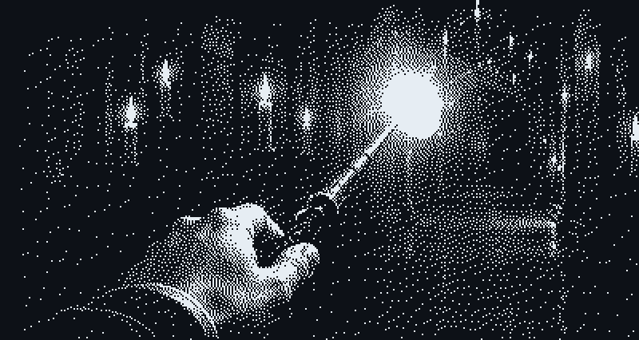

  
 <h1 align="center">Hi 👋, I'm Tousni</h1> <h3 align="center">Aspiring IT student · Interested in Cybersecurity</h3> 
  

<h2 align="center">🪄 About Me</h2> 

I'm Tousni, an aspiring IT student.

I'm interested in cybersecurity and Spring Boot, and I'm learning both one project at a time.

I practise on TryHackMe and HackTheBox.

This is where I keep what I build along the way.

"Happiness can be found, even in the darkest of times, if one only remembers to turn on the light." — Albus Dumbledore

 
<h2 align="center">💻 Learning With</h2> 
  
 <h2 align="center">📊 GitHub Stats</h2> 
  

  

